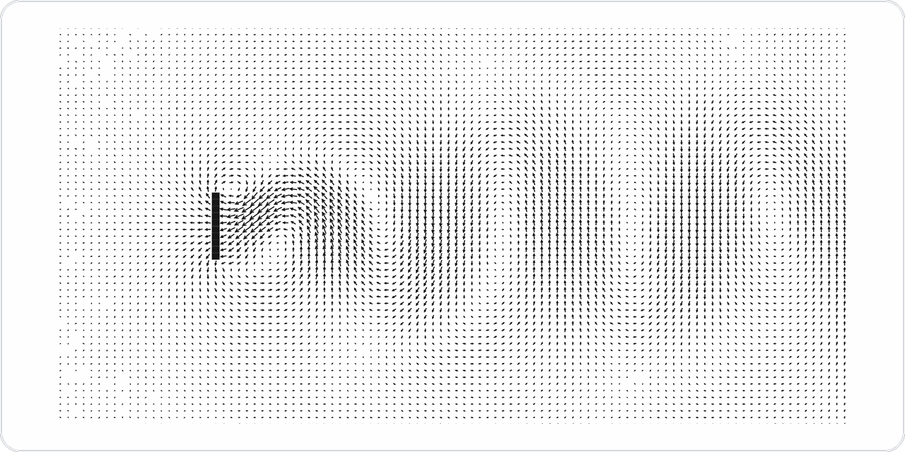

<h1 align="center">lattice-gas</h1>

<p align="center">A cellular-automaton fluid in Rust: particles on a hexagonal lattice that shed a vortex street.</p>

<p align="center">
  <a href="#quick-start"><b>Quick start</b></a> &nbsp;·&nbsp;
  <a href="#documents">Documents</a> &nbsp;·&nbsp;
  <a href="#how-it-works">How it works</a> &nbsp;·&nbsp;
  <a href="docs/benchmarks.md">Benchmarks</a>
</p>

<p align="center">
  
</p>

A Rust implementation of the lattice-gas model used for the fluid-flow images in
Wolfram's *A New Kind of Science*, pp. 378–380. Nothing in its rule refers to
pressure, viscosity or velocity, yet past an obstacle the gas separates, forms a
recirculating wake, and sheds a von Kármán vortex street. On macOS it runs on
the GPU, and the default run, 9.4 million cells, takes about nine seconds on an
M3 Pro. It has no dependencies.

## Quick start

```bash
cargo build --release
./target/release/lgca              # the default run: frames into out/
./target/release/lgca --measure    # measure the viscosity and advection factor
./target/release/lgca --help       # every option
cargo test                         # the checks
cargo bench                        # the benchmarks
```

Each frame is a vorticity colour map and a velocity-arrow plot, like the one
above. See [Running it](docs/running.md) for the options, making a movie, and
reproducing the book's figure.

## Documents

| Document | What's in it |
| -------- | ------------ |
| [Running it](docs/running.md) | Building, the default run and its pictures, the options, the book's figure, and the limitations |
| [The rules](docs/rules.md) | The collision rule, rest particles, obstacles and the inflow |
| [Transport coefficients](docs/transport.md) | Measuring the viscosity and advection factor, and how they compare with FHP theory |
| [Checks](docs/checks.md) | What the tests cover, for both the CPU and GPU paths |
| [Benchmarks](docs/benchmarks.md) | The recorded speeds, what each case is for, and where the time goes |
| [Plan](docs/plan.md) | The plan for making it faster |

## How it works

Identical particles sit on the links of a hexagonal lattice, each moving one
site per step in one of six directions, and optionally a seventh, resting.
When particles meet, they are rearranged by a rule that conserves the number of
particles and their total momentum; the rule is generated, not hand-written.
Averaged over blocks of cells, the gas behaves like a continuum fluid. On the
GPU the lattice is stored as bitplanes, one bit per cell per direction, so a
collision is Boolean algebra on 32 cells at once. [The rules](docs/rules.md)
has more.

---

<p align="center"><sub>Part of <a href="https://daleobrien.github.io/#engineering">Engineering</a> &nbsp;·&nbsp; more at <a href="https://daleobrien.github.io">daleobrien.github.io</a></sub></p>
