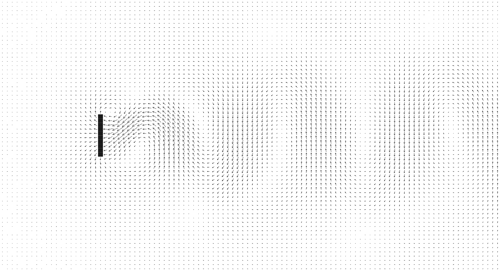
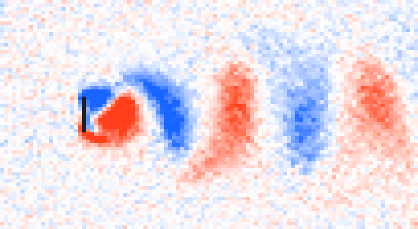

# Running it

[Back to the README](../README.md)

```bash
cargo build --release
```

```bash
./target/release/lgca
```

The defaults are chosen to reproduce the book's picture on a laptop: 6144 x
1536 cells, a plate 173 cells across, Reynolds number near 100. That is 9.4
million cells in about 30 MB, and some nine seconds on an M3 Pro. The lattice
is far wider than it is tall because a vortex street is: the wake needs room to
shed a dozen vortices before it runs off the end. On a machine with no GPU the
same run is minutes rather than seconds, and `--width 2048 --steps 20000` is
the thing to reach for.

On macOS the update runs on the GPU by default, as bitplanes -- one bit per
cell per direction, 32 cells to a word, so a collision is Boolean algebra
evaluated on 32 cells at once. `--no-gpu` runs the byte-per-cell CPU kernel
instead, which is the reference implementation and about forty times slower.
The header line says which one is running. Frames are encoded on their own
threads, so writing them does not hold the simulation up.

Each frame is written twice: `vorticity-NNNN.png`, a colour map of the
vorticity (blue and red for the two senses of rotation), and
`arrows-NNNN.svg`, a velocity-arrow plot in the style of the book's figure,
with the mean flow subtracted so the fluid is at rest and the obstacle moves.



*A shorter 2048 x 1280 run as an arrow plot. With the mean flow subtracted the
plate is the thing that is moving, which is how the book presents it.*

`--alpha` defaults to `--sample-every / 25`, which holds the running time
average over a fixed 25 steps however often the field is sampled. That matters
on a big lattice, where sampling is 10% of a step: raising `--sample-every`
without it would quietly lengthen the average and smear the vortices as they
advect, rather than saving anything. What a longer interval does cost is noise,
since the average then holds fewer samples --- roughly `(1/alpha) * block^2`
cells --- so it wants a bigger `--block` to pay for itself.

`--help` lists every option. To turn the frames into a movie, if you have
ffmpeg:

```bash
ffmpeg -framerate 20 -i out/vorticity-%04d.png -pix_fmt yuv420p flow.mp4
```

## The default run



*Vorticity after 40,000 steps of the default run: a 6144 x 1536 lattice at a
Reynolds number near 100, long enough downstream to hold a dozen vortices. Blue
and red are the two senses of rotation; the black bar is the plate.*

## Reproducing the book's figure

The book's parameters are six directions, no rest particles, one particle per
cell, and an inflow at 0.4 of the maximum speed. Measured, that combination
gives `nu = 0.91` and `g = 0.41`, hence `Re = 0.45 * U * L` -- so a Reynolds
number of 100 needs an obstacle roughly 560 cells across, and a lattice of tens
of millions of cells. That is exactly the 30 million cells the book reports
using, which is a satisfying way to arrive at someone else's parameter choice
from the other end.

```bash
./target/release/lgca --no-rest --density 0.1667 --width 8192 --height 4096 \
    --size 560 --obstacle-x 1600 --warmup 40000 --steps 150000 \
    --frame-every 2000 --out out-nks
```

Expect this to take a while. The default settings reach the same Reynolds
number on about a sixth as many cells.

## Speed

`cargo bench` runs the benchmark suite in [`benches/speed.rs`](../benches/speed.rs) and reports the
change against the numbers recorded in [`benches/baseline.txt`](../benches/baseline.txt). The cases cover
the update kernel at both cache-resident and production sizes, threaded and
not, on the CPU and on the GPU, the coarse-graining and analysis passes on
both, the PNG and SVG writers, and the startup viscosity measurement. [the benchmarks](benchmarks.md) has the recorded
figures, what each case is for, and where the time in a default run actually
goes -- which is not where one would guess.

## Notes and limitations

* The bulk density settles a few percent below the inlet density, with the
  speed a few percent above it, so that the mass flux matches. This is a
  compressibility effect of the open outlet at Mach 0.57, and it is stable; the
  status line reports the realised values.
* Row count must be even, so the lattice wraps cleanly in y.
* The top and bottom edges are periodic, not walls.
* No dependencies: the PNG writer, the random number generator, the thread pool
  and the Metal binding are all in-tree. `Cargo.lock` lists one package.
* The two paths do not produce the same lattice: they draw from different
  random streams, so they agree on the fluid and not on the microstate.
